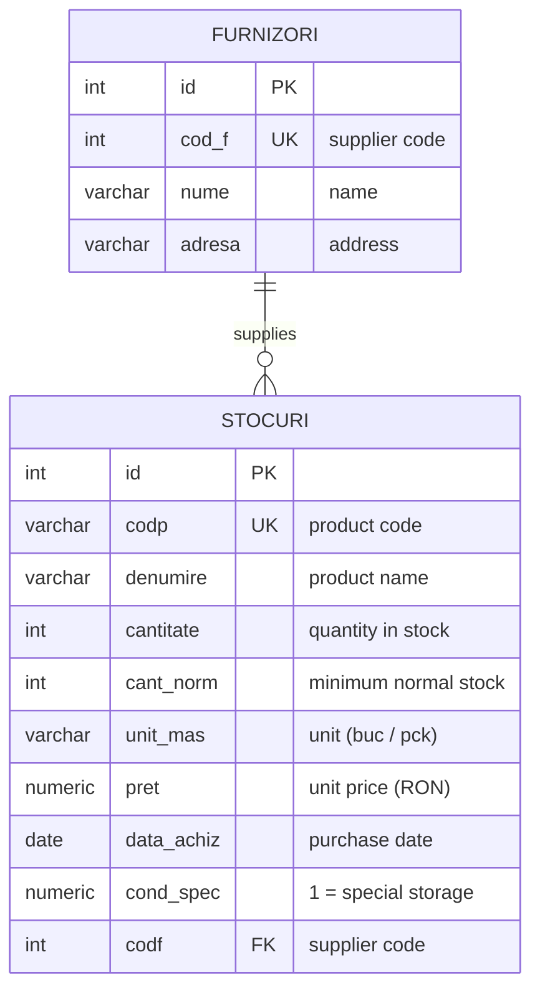

# Clothing Store Management — SQL Database

A relational database for managing the stock and suppliers of a clothing store. It started as an **Oracle APEX** web application I built during the **Oracle Academy** database course (2025). The app had data-entry pages, reports, price charts and authentication. This repository contains the database behind it: the schema, sample data and all the report queries, written in portable SQL.

> Table and column names are in Romanian, as in the original project (`stocuri` = stock, `furnizori` = suppliers).

## Schema



- Primary keys, unique codes, a **foreign key** from each product to its supplier.
- `CHECK` constraints keep the data valid: no negative stock, positive prices, `cond_spec` is only 0 or 1.

## Reports (`queries.sql`)

| # | Report | SQL used |
|---|--------|----------|
| 1–2 | Products / suppliers in alphabetical order | `ORDER BY` |
| 3 | **Products that need restocking** (stock below the normal level) and how many to order | `WHERE`, computed column |
| 4 | Products that need special storage conditions | filtering |
| 5, 9 | Products by price (also the data for the price chart) | sorting |
| 6–8 | Highest price, number of suppliers, the most expensive product | `MAX`, `COUNT`, subquery |
| 10 | Every product with its supplier | `JOIN` |
| 11 | Number of products and **stock value per supplier** | `LEFT JOIN`, `GROUP BY`, `SUM` |
| 12–13 | Total stock value, products above the average price | aggregates, subquery |
| 14 | Purchases per month | `TO_CHAR`, `GROUP BY` |
| 15 | Suppliers to contact for restocking | `JOIN`, `DISTINCT` |

Example — products that need restocking:

```sql
SELECT codp, denumire, cantitate, cant_norm,
       cant_norm - cantitate AS de_comandat
FROM stocuri
WHERE cantitate < cant_norm
ORDER BY de_comandat DESC;
```

## How to run

The scripts run unchanged on **Oracle Database (12c+)** and **PostgreSQL (13+)**.

```bash
# PostgreSQL
createdb magazin
psql -d magazin -f schema.sql -f data.sql
psql -d magazin -f queries.sql
```

On Oracle, run `schema.sql`, `data.sql` and `queries.sql` in this order (for example in SQL Developer or the free Oracle Live SQL).

## Files

```
schema.sql         tables, keys and constraints
data.sql           sample data (5 suppliers, 20 products)
queries.sql        the 15 reports
data/*.csv         the same sample data as CSV
```

## Tech

SQL · Oracle Database · Oracle APEX · PostgreSQL
